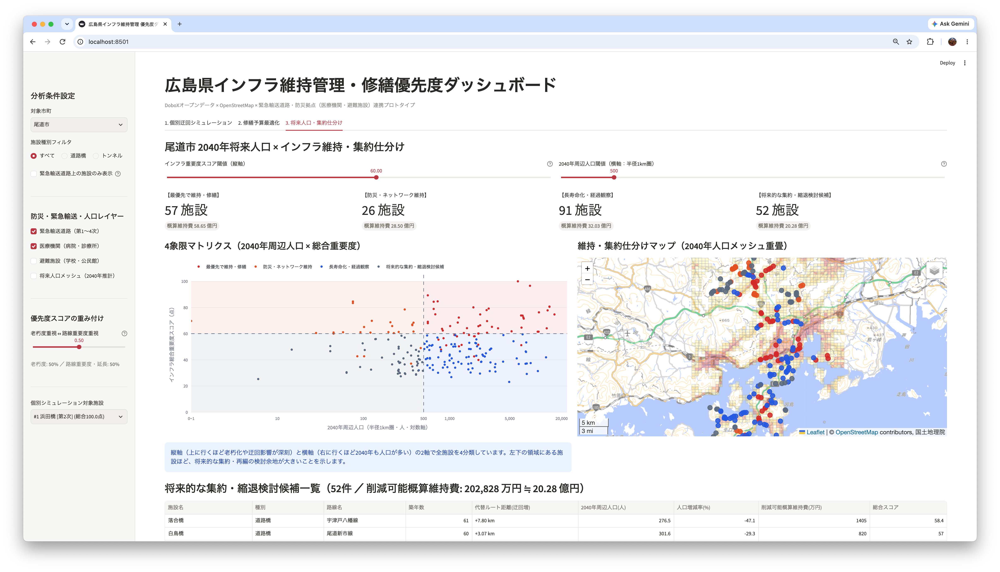

# 広島県インフラ維持管理・修繕優先度ダッシュボード

広島県（広島市を除く県内 22 市町）の道路橋 **4,199 橋**・道路トンネル **155 箇所**（計 **4,354 施設**）を対象に、単なる老朽度だけでなく「通行止め時の迂回・孤立リスク」「緊急輸送道路・救急搬送への影響」「2040 年将来人口」を統合して修繕優先度と集約候補を可視化する意思決定支援ダッシュボードです。

- **公開デモ**: https://hiroshima-infra.streamlit.app
- **対象範囲**: 広島市を除く広島県内 22 市町（※広島市は政令指定都市であり、市内の県道・橋梁等を広島市が独自管理しているため DoboX 公開データに含まれません）



---

## 主な機能

### 1. 個別迂回シミュレーション（地図 × ランキング連動）
- **対象市町・施設種別・緊急輸送道路フィルタ**による即時絞り込み
- **通行止め迂回・孤立自動判定**: 対象施設の最寄り道路区間を通行止めとして最短経路を再計算し、迂回増加距離や「迂回路なし（孤立）」を地図上（赤線：通行止め、青破線：迂回ルート）に描画
- **防災拠点・病院搬送遅延連携**: 第 1 次〜第 4 次緊急輸送道路から 30 m 以内の施設を空間判定（`Shapely STRtree`）し、通行止め時の最寄り医療機関への搬送遅延・遮断リスクも含めて総合優先度（S〜C ランク）を算出
- **レイヤー重畳表示**: 緊急輸送道路（第 1〜4 次）、医療機関、避難施設（学校・公民館）、2040 年将来推計人口メッシュを背景地図（国土地理院タイル）上に重ね合わせ

### 2. 修繕予算最適化
- 施設の面積（延長 × 幅員）と経過年数から概算修繕コスト（万円）を推計
- 設定した年間修繕予算（スライダー）の上限内で総合優先度が高い順に修繕対象を自動選定（貪欲法）
- 「今回修繕する施設（青）」と「予算不足で見送られる高リスク施設 S / A（赤）」を地図・一覧表で比較し、高リスク解消数や迂回リスク削減率（%）を即時算出

### 3. 将来人口・集約仕分け
- 施設半径 1 km 圏内の 500 m メッシュ将来推計人口（2020 年・2040 年）を集計
- 横軸（2040 年周辺人口・対数スケール）× 縦軸（総合重要度スコア）の **4 象限マトリクス** により、全施設を以下の 4 区分へ動的に分類
  - **最優先で維持・修繕**（人口多い × 重要度高い）
  - **防災・ネットワーク維持**（人口少ない × 重要度高い）
  - **長寿命化・経過観察**（人口多い × 重要度低い）
  - **集約・縮退検討候補**（人口少ない × 重要度低い）

---

## スコア算出・コスト推計ロジック

- **構造物リスクスコア（`risk_score`, 0〜100 点）**
  - `aging_weight × 老朽度スコア + (1 - aging_weight) × 路線重要度スコア`（`aging_weight` はサイドバーで調整可能、初期値 `0.5`）
  - **老朽度スコア**: 築 50 年以下は `(築年数 / 50) × 75`、築 50 年超は最大 100 点まで加算
  - **路線重要度スコア**: `0.6 × 道路種別（国道 100 / 主要地方道 75 / 県道 55 / その他 35） + 0.4 × 延長対数スコア`
- **総合優先度スコア（`combined_score`, S〜C ランク）**
  - `min(100, 0.65 × risk_score + 0.35 × detour_score + 緊急輸送ボーナス + 病院搬送遅延ボーナス)`
  - **迂回スコア（`detour_score`）**: 孤立（迂回路なし）= 100 点、迂回増加 20 km 以上 = 100 点
  - **緊急輸送ボーナス**: 30 m 以内（第 1 次 +12 / 第 2 次 +7 / 第 3 次 +4 / 第 4 次 +2 点）
  - **病院搬送遅延ボーナス**: 孤立（遮断）= +10 点、遅延 5 km 以上で最大 +8 点
  - **優先度ランク**: S（80 点以上）/ A（65 点以上）/ B（50 点以上）/ C（50 点未満）
- **概算修繕コスト（万円）**
  - `max(100, 延長 × 幅員 × 単価 × (1 + max(0, 築年数 - 20) × 0.015))`
  - 単価係数: 道路橋 15 万円/m²、トンネル 20 万円/m²（幅員欠損・0 の場合は 6.0 m で補完）

---

## 使用オープンデータ

| 提供元 | データセット名 | ファイル名 / 利用用途 |
| :--- | :--- | :--- |
| **広島県（DoboX）** | 道路橋データ | `340006_road_bridge_2023.csv` |
| **広島県（DoboX）** | 道路トンネルデータ | `340006_road_tunnel_2023.csv` |
| **広島県（DoboX）** | 緊急輸送道路（第 1〜4 次） | `05_kinkyu_route_01.json` 〜 `05_kinkyu_route_04.json` |
| **国土交通省（国土数値情報）** | 500m メッシュ別将来推計人口データ（広島県） | `500m_mesh_2018_34.shp` 等（2020 年・2040 年推計） |
| **OpenStreetMap** | 道路ネットワーク・医療機関・避難施設 POI | Overpass API / 事前構築キャッシュ（`.cache/osm/`） |
| **国土地理院** | 地理院タイル（標準地図） | Folium 背景地図タイル |

---

## ローカル環境でのセットアップ・起動方法

### 1. 依存ライブラリのインストール
Python 3.10 以上を推奨します。

```bash
python -m venv .venv
source .venv/bin/activate  # Windows の場合: .venv\Scripts\activate
pip install -r requirements.txt
```

### 2. アプリの起動

```bash
streamlit run app.py
```

起動後、ブラウザで `http://localhost:8501` を開きます。

---

## ファイル構成

- `app.py`: Streamlit ダッシュボード本体（UI・3 タブ構成・地図/グラフ描画）
- `data_loader.py`: DoboX 橋梁・トンネル CSV の統合・和暦変換・正規化
- `emergency_loader.py`: 緊急輸送道路（第 1〜4 次）および医療機関・避難施設の読み込み・空間判定
- `population_loader.py`: 国土数値情報 500 m メッシュ将来推計人口の空間集計
- `network_analyzer.py`: 道路網構築、迂回・孤立計算、病院搬送遅延、スコア算出、予算最適化、4 象限分類
- `requirements.txt`: Python 依存パッケージ一覧
- `poster.html`: コンテスト応募用紹介ポスター（A4 縦印刷用 HTML/CSS）
